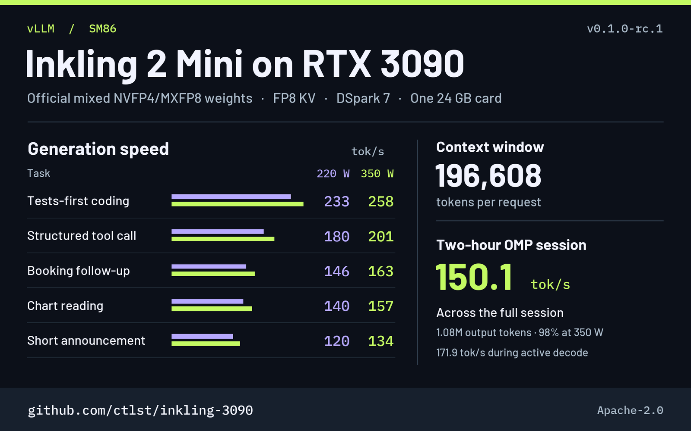

# Inkling 2 Mini on an RTX 3090

This release candidate packages the vLLM model-code changes used on one 24 GB RTX 3090. Docker builds a thin layer on top of the pinned upstream vLLM image. The user downloads the official Inkling checkpoint separately. The image contains the SM86 patch and its verification manifest.

## Serving profile

| Setting | Value |
|---|---|
| Target | Official Inkling 2 Mini, mixed NVFP4/MXFP8 expert weights |
| Draft | Official `mtp.safetensors`, DSpark, seven greedy proposals |
| Target KV | FP8, 5,100,273,664 bytes reserved |
| Context and concurrency | 196,608 tokens, one active sequence |
| Prefill and decode | 512-token prefill chunks, full decode-only CUDA graphs |
| Placement | Experts in VRAM, input embeddings and vision weights in pinned host RAM |
| Hardware used | Linux x86-64, RTX 3090 24 GB, NVIDIA driver 595.58.03 |

The patch includes SM86 compatibility for expert routing and FP8 cache access, long-context prefill and split decode kernels, and a hybrid FlashAttention-2 path for eligible full-attention prefill chunks at 65,536 tokens of history and above. The compact expert-routing kernel comes from our earlier Muse kernels competition work. Run the image with your existing GPU power limit and fan policy.

## Build and run

Use a dedicated GPU with Docker Compose and NVIDIA Container Toolkit. Install the Hugging Face CLI on the host. Run these commands from this repository. The target and draft together require about 20.2 GB of disk space, in addition to the base image and runtime caches. First startup can take time to compile GPU kernels.

```bash
export MODEL_DIR="$PWD/weights"
hf download thinkingmachines/Inkling-2-Mini \
  --revision ed40e7da625f594fc9c4990f5f66be24873c22d7 --local-dir "$MODEL_DIR"
manifest="$PWD/checks/checkpoint.sha256"
(cd "$MODEL_DIR" && sha256sum -c "$manifest")
docker compose up -d --build
docker compose logs -f inkling
```

On macOS, use `shasum -a 256 -c "$manifest"` in the checkpoint directory for the verification step.

The default endpoint is loopback port 8000. Set `PORT` before startup to choose another local port. Once the server reports ready, run the following checks.

```bash
python3 checks/api.py "http://127.0.0.1:${PORT:-8000}"
docker compose down
```

With the server stopped and the GPU free, run the low-level FP8 and expert-routing checks inside the candidate image.

```bash
docker run --rm --gpus all --entrypoint python3 \
  -v "$PWD/checks:/checks:ro" inkling-3090:rc-local /checks/kernels.py
```

## Release benchmarks at 220 W and 350 W



The 350 W results use the public tag built on the same GPU, with the same official weights, FP8 target KV and seven greedy draft proposals. The coding result is one checked generation at each power cap. The other rows are per-prompt medians across three trials after warmup; the chart image is cached and the announcement has a 256-token thinking budget. The older two-hour OMP result includes retries and reasoning. The 150.1 tok/s figure divides all output tokens by total session time. [350 W benchmark records](benchmarks/official-350w.json) · [Download the release card](https://github.com/ctlst/inkling-3090/releases/download/v0.1.0-rc.1/inkling-3090-release.png)

## Measurements on the reference deployment

| Two-hour OMP workload | Result |
|---|---:|
| Active decode, weighted by decode time | 171.9 tok/s |
| App generation and repair | 175.9 tok/s |
| Browser test generation | 155.3 tok/s |
| Output over total elapsed time | 150.1 tok/s |
| Output tokens, including reasoning and retries | 1,079,250 |

The 119.8-minute workload built and tested offline apps. We measured this workload with the reference card capped at 350 W for 98% of samples and 220 W for the remainder. Of 57 attempts, 31 passed the desktop, mobile and behavioral checks, including seven after app repair. Another 23 had failing checks and three were incomplete. These measurements describe the live deployment from which the patch was extracted. The packaged candidate has since passed a separate cold boot and replay at the reference box’s existing 220 W limit. [Session measurements](benchmarks/omp-3090.json)

### How much does drafting help?

We measured the same five AgentX requests with the reference card capped at 220 W, first with DSpark off and separately with seven draft proposals. Prompt hashes and output lengths matched. AgentX Harness 1.0.7 generated these five top-level calls from one Weka trace. Our local replay fixes output lengths and measures speed. Each setup had one pass per cache mode. Only aggregate timings and request hashes from this local replay are distributed. The four task fixtures below can be run directly from this repository. The full SemiAnalysis scenario also represents recorded delays and subagent activity. [AgentX methodology](https://inferencex.semianalysis.com/infx/agentx)

| AgentX workload | Decode on turns 2–5, off → on (tok/s) | Total request time, all five turns, off → on | Time saved |
|---|---:|---:|---:|
| Cold prompts | 71.5 → 121.5 | 138.79 → 128.05 s | 7.7% |
| Shared session prefix | 71.4 → 103.3 | 52.07 → 43.28 s | 16.9% |

The cold prompts spent much of their time waiting for the first token. Drafting can accelerate the answer while saving only a few seconds on the whole request. On this replay DSpark accepted 36.5% of proposed tokens with cold prompts and 28.3% with a shared prefix. A separate tests-first coding run accepted 65.6%. Acceptance depends on the generated text, and total latency also depends on prompt length and cache reuse.

### Chat, writing, tools and vision on the packaged image

Each row uses one fixed prompt, one warmup and three timed trials per mode. Both modes use the same release image, greedy decoding, a 1,024-token output cap and the reference card measured at 220 W. Requests use fresh prefix-cache salts and a warm engine. The vision test repeats the image after warmup. Output counts include reasoning. Checks cover the expected answer, structured arguments, chart order or selected writing constraints.

| Fixture | Median seconds, off → on | Output tokens, off → on | DSpark acceptance | Checks passed, off → on |
|---|---:|---:|---:|---:|
| Room-booking follow-up | 1.37 → 0.88 | 118 → 118 | 35.7% | 3/3 → 3/3 |
| Rail schedule function call | 1.38 → 0.83 | 118 → 133 | 49.0% | 3/3 → 3/3 |
| Rank bars in a chart | 1.43 → 0.95 | 124 → 124 | 32.7% | 3/3 → 3/3 |
| Library announcement | 11.51 → 7.62 | 1024 → 912 | 26.7% | 0/3 → 3/3 |
| Same announcement, bounded thinking | 4.73 → 3.55 | 417 → 417 | 27.2% | 0/3 → 3/3 |

The unconstrained-thinking writing run exhausted its output budget with drafting off and returned an empty final answer. Its elapsed time cannot measure speed to an equivalent completed answer. The follow-up set a 256-token thinking budget on both engines. Both then returned an announcement, but the no-draft version omitted the roof repair. The 233.0 tok/s coding result applies to a different prompt. These fixtures measure the given requests; they do not estimate a workload-wide average. Run `python3 benchmarks/workloads.py URL results.json` on an isolated endpoint in each mode, then repeat with `--bounded-prose`. [Per-request outputs, timings and checks](benchmarks/workloads-3090.json)

## Packaged candidate validation

The candidate built from the pinned image and verified patch reached health in 69.3 seconds on a fresh container with new runtime cache volumes. The official checkpoint was already on local disk. At readiness the card used 23,565 MiB of its 24,576 MiB. Arithmetic, image recognition, structured tool calling, the FP8 codec and 48 routed batches passed. The tests-first coding output matched the saved reference by SHA-256 and passed 17 external checks and 22 embedded tests at 233.0 decode tok/s.

| Five-request replay at 220 W | Live reference | Packaged candidate |
|---|---:|---:|
| Cold prefixes, summed wall time | 128.05 s | 130.84 s |
| Shared prefixes, summed wall time | 43.28 s | 43.73 s |

All five prompt hashes and input/output lengths matched in each pass. Each configuration recorded zero cold cache hits and 195,712 shared-prefix hits. The candidate also answered the 195,015-token retrieval fixture correctly with zero cached tokens and 105.36 s to first token. Each configuration had one measured pass per cache mode. [Cold-boot measurements and per-turn results](benchmarks/cold-boot-3090.json)

## Accuracy against upstream

All three runs completed the same 24 public MMLU-Pro questions. The tuned 3090 and the upstream B200 target alone each scored 17/24 and chose the same letter on every item. Upstream B200 with DSpark 7 scored 18/24 and agreed with the 3090 on 22/24 choices. All three answered the same 195,015-token LongBench v2 retrieval question correctly. In an earlier time-limited attempt, the B200 target alone selected three different answers on repeated items. [Protocol, reproduction commands and item-level results](benchmarks/accuracy.md)

## Upstream and release status

The pinned checkpoint revision and registry image are recorded in the download command and Dockerfile. The model and vLLM are upstream dependencies. This candidate targets the RTX 3090. Other GPU families require separate validation. [Official checkpoint](https://huggingface.co/thinkingmachines/Inkling-2-Mini/tree/ed40e7da625f594fc9c4990f5f66be24873c22d7) · [Dockerfile](Dockerfile) · [Release notes](RELEASE.md)

The source patch and measurement tools are distributed under [Apache-2.0](LICENSE). [Notices](NOTICE)
